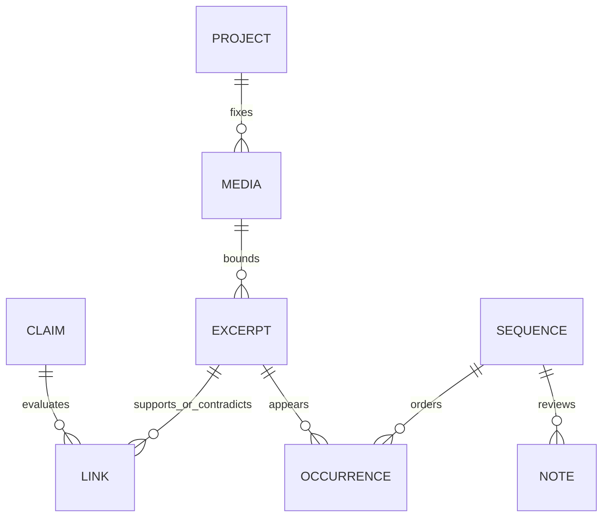

# 领域与本体设计

## 专业聚合

Media固定媒体、Excerpt采访选段、Question研究问题、Claim叙事主张、Link证词关系、Sequence纸上剪辑、Occurrence独立出场、Note固定意见。根字段：media、excerpts、questions、claims、links、sequences、notes、basis_refs。专业对象以WorkRef＋owner_plugin_id＋object_id确定身份，revision＋sha256固定内容。相同标题不代表同一对象。

媒体与原始选段只追加，逐字引文核对固定文字来源；入出点必须位于完整回读的真实媒体容器时长内。文本匹配不证明录音说过这些话，timing_note明确对齐依据。证词关系分支持、反证和背景，不按数量判定事实。纸剪固定选段、主张、证词关系和问题组合摘要，旁白标明估时，素材重复出场各有独立ID。新建和主动改动编排须匹配当前摘要，旧编排保留过期；原意见不能默套新稿。MP4检查只核验容器与元数据，不冒充全帧解码或内容认可。

所有集合ID唯一、所有引用存在、集合有界、顺序在对应父级唯一。撤销先处理依赖，不能制造悬空引用；来源索引只追加，整本保存不能改变原索引意义。跨包引用只携带固定Owner、对象、修订与摘要，通过公开SDK回读，不导入对方私有结构。

## 权属

原始资料、作品身份与受管事务归Core；专业记录归本包；理解、创作与解释归作者选择的外部Agent；表达取舍与定稿归作者。借助欧卡姆原理复用通用事实，只增加本旅程需要的专业状态。
